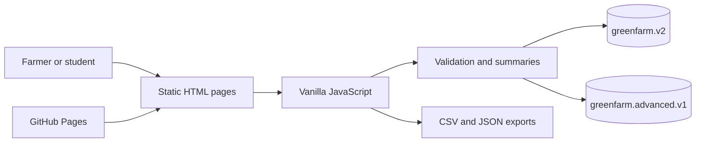

# GreenFarm Project Report

**Smart Digital Farm Management System**  
**Submitted by:** KOWSHIK S.  
**Institution:** Agricultural College & Research Institute, Vazhavachanur · Tamil Nadu Agricultural University

## Project overview

GreenFarm is a browser-based workspace for keeping farm records in one place. It organizes crop and livestock records, field observations, irrigation, scouting, harvest, finance, inventory and planned work. The interface is designed for a TNAU academic demonstration and uses a green-and-gold agriculture theme.

## Problem and objectives

Farm notes and operational records can be difficult to organize and review across separate forms. GreenFarm provides one clear place to enter, search, export and print those records.

- Organize common crop, livestock and farm operation records.
- Highlight upcoming and overdue work.
- Summarize entered income, expenses, harvest and crop-linked costs.
- Support local JSON backup and CSV export.
- Keep the app usable on phones, tablets and desktop computers.

## Methodology

1. The user enters records through labeled forms.
2. The browser validates required fields and numeric/date inputs.
3. Records are saved locally in the browser.
4. Dashboard, activity, analytics and report pages read saved records and calculate summaries.
5. Users can search, filter, sort, edit, delete, print or export records.
6. A service worker caches successful same-origin pages and assets for offline access.

## System architecture

The project uses static HTML, CSS and vanilla JavaScript hosted on GitHub Pages. Workspace records use `greenfarm.v2`; Farm Center records use `greenfarm.advanced.v1`. These LocalStorage stores stay separate. Shared pages read the data for summaries without moving records between stores. The app has no backend, account service, API keys, cloud database or cross-device synchronization.

## Features

- Responsive navigation, farm overview, dashboard and quick actions.
- Crop, livestock, activity and task records with search, filters, sorting and pagination.
- Optional compressed photos on crop and scouting records; photos remain in the browser.
- Manual weather logs and irrigation planning. Applied-water volume is estimated from entered depth and a matched field area.
- Farm income, expenses, harvest and inventory records.
- Monthly analytics, crop-wise tagged costs, harvest value and yield summaries.
- Date-filtered printable reports, CSV exports and JSON backup/restore.
- Offline caching for successful local pages and assets.

## Limits and interpretation

- Data is available only in the current browser profile and device. Back up records before clearing browser data or switching devices.
- Weather is entered by the user; GreenFarm does not fetch live conditions.
- Irrigation volume is a unit conversion from recorded depth and area. It does not calculate crop water needs.
- Crop outlook is a broad rule-based aid, not a yield prediction or a treatment recommendation.
- Crop economics are based on values entered by the user. Costs count toward a crop only when tagged, and harvest value needs entered quantity and sale price.
- Agricultural decisions and pesticide treatments must follow local product labels and TNAU or extension guidance.

## Update workflow

Edit the source HTML/CSS/JavaScript and `build.py`, keep generated pages in sync, commit to `main`, then confirm the GitHub Pages deployment and live pages. Export JSON backups before changing devices or clearing browser storage.

## Academic credit

**KOWSHIK S. · AC&RI Vazhavachanur · TNAU**
